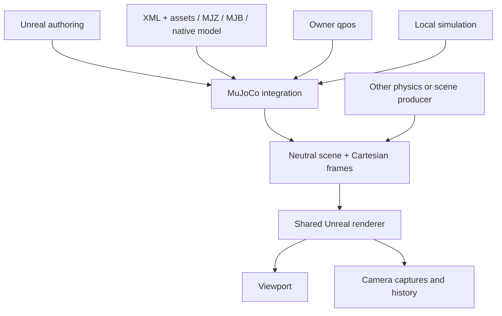

# URLab intended architecture

URLab is the Unreal plugin; `urlab_bridge` is its Python connector. The plugin has three cooperating parts: scene authoring, a physics-independent renderer, and a MuJoCo integration. They do not depend on each other in a chain: a scene and Cartesian poses supplied by another physics engine can use the same renderer without constructing a MuJoCo model.

This page states the target architecture. [Completion status](completion_status.md) records what has been verified in the current implementation. The earlier investigation and implementation history remain in the workspace audit record; they are not statements of current support.

## Boundaries

**Authoring.** `AMjManager`, `AMjArticulation`, and quick components are editor/level authoring tools. Their compiler produces an owned MuJoCo candidate and presentation data for a world-owned simulation service. Runtime simulation and rendering do not require a manager or articulation actor. An externally loaded model and an authored model use the same runtime state contract. Articulation names may remain useful authoring metadata, but do not partition runtime control or observations.

**Renderer.** The renderer accepts a renderable scene, owned resources, and Cartesian frames. Scenes describe geometry, materials, lights, cameras, optional deformation and visualization. A frame identifies its scene revision and source frame, and carries object/camera/light poses and supported dynamic geometry. The renderer does not run `mj_step`, perform MuJoCo forward kinematics, decode wire payloads, arbitrate ownership, or choose a control source. Viewport display and camera captures use this rendering path.

**MuJoCo adapter.** The adapter extracts neutral scenes/resources from compiled authoring output, an in-process `mjModel`, or transferred MJB, MJZ, or XML with assets. MJB, MJZ, XML with asset bytes, and compiled authoring input are primary load paths, each requiring independent acceptance coverage; incompatible MJB recovery is additional transfer behavior. It derives Cartesian frames from live `mjData`, owner-supplied Cartesian poses, or owner-supplied `qpos` using `mj_forward`. Rendering a `qpos` frame is not a simulation step. MuJoCo-specific topology, coordinate conversion, skin/flex and diagnostic extraction stay here.

**Simulation.** A world-owned runtime owns the model, data, stepping clock, control authority, observations, and checkpoints. State is addressed by model names/indices and arrays, not authoring actors. One active simulation control source is the initial rule; changing it does not change the clock. Explicit step and freerunning modes are separate choices. Checkpoints use MuJoCo state extraction/restoration with model/layout validation; sensor observations and Cartesian render frames are different products.

## Workflows and authority

| Workflow | URLab responsibility | Bridge responsibility |
|---|---|---|
| Simulation | Own MuJoCo, step/reset, accept authorized controls, publish state, sensors and cameras | Explicitly claim control or read outputs |
| Render server | Accept one owner's scene/poses, schedule captures, return exact results | Own the submitted source and request/collect images, including through a pool |
| Viewer | Follow one owner's scene and newest poses, display/capture, forward permitted interactions | Publish authoritative scene/poses or read a URLab-owned stream |

An owner supplies the authoritative scene and poses. A viewer follows one active owner; a render server accepts one active owner at a time, with explicit release/reassignment. Other clients may read permitted output. Simulation control authority, scene ownership, and process reservation are distinct. A controller may operate a URLab-owned simulation without becoming owner of downstream viewers. A viewer perturbation is a request to the owner, not a competing pose source.

Scene replacement assigns a new revision. Poses, pending jobs, and retained history carry revision and frame identity so work from the old scene cannot be mislabeled as new. Accepted capture jobs terminate with a result or explicit failure/cancellation; retained exact results are collected separately. Viewer display may coalesce intermediate live poses, and disconnect retains the last display while marking the source stale. Fresh capture, asynchronous jobs, and delayed/history queries share camera resources but have distinct scheduling semantics. A missing delayed frame is reported as missing history.

Pose input chooses one authoritative representation per submission: Cartesian frames or `qpos`. Camera overrides and persistent geom/scene edits are separately validated. Full scene/source installation replaces topology or resources; persistent edits atomically advance the local scene revision. The owner and expected revision must authorize each mutation.

## Bridge and scope

Retained wire operations and nested payloads have generated declarations with explicit authority, lifecycle and adapter support. An omitted declaration never grants unrestricted access.

The Python package exposes explicit `Connection`, `SimulationClient`, `RenderClient`, `ViewerClient`, `EditorClient`, `PoseStreamPublisher`, `OutputReader`, and process/pool APIs. Connecting is passive: it does not start PIE, claim control, or install a source. Editor automation can move authoring actors and start PIE; the simulation client operates an already available runtime. Render pools can launch workers or attach to existing endpoints and collect cameras in parallel with matching scene/frame identity.

The retained low-level simulation API includes controls, step/reset, observations, model descriptors and snapshots. Gym/task wrappers, reward/termination policy, VR, recording/replay, per-robot control arbitration, multi-owner scheduling and general gRPC simulation/viewer parity are outside this cleanup. ROS remains a separate later adapter alignment and is not a renderer dependency. No backward compatibility layer is provided for removed articulation runtime APIs or implicit bridge client behavior.

[Transport design](transport_design.md) defines command/data profiles and payload lifetimes.
