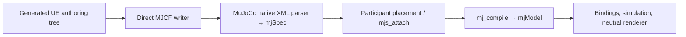

# Architecture: components to native MuJoCo simulation

URLab's generated `UMjNodeComponent` tree is the persistent authored model. The direct XML gateway walks either a Blueprint SCS template graph or a live actor graph, using generated field and child descriptors. Ordinary MJCF attributes retain their schema spelling; alternate orientation and `fromto` spellings are normalized at import. Original `fromto` endpoints are discarded. Normalized geom/site half-extents remain an atomic optional value inherited through default classes, and export maps them through each element's effective type.

The XML writer receives transient per-node asset filenames and reserved names without mutating authored fields. The asset collector supplies compiler-ready bytes to MuJoCo's VFS. The native parser constructs each participant spec and interprets shortcuts, aliases and defaults; the compiler validates physics. URLab retains scene composition because participants can be placed independently and attached under different conflict policies. A failed attach causes the whole build to be discarded.

The old direct `MjSpecBuild` walk, handwritten write hooks, generated native write backend, plain C++ AST, cross-profile SDK and generic MJCF reader/writer were removed. The retained ProtoSpec C++ helpers are limited to native-backed orientation/full-inertia resolution, source-aware `<include>` expansion, tinyxml2 and a test-only native `mjModel` comparison library. Runtime simulation and the neutral renderer remain independent of authoring components.

The key checks are generated-code drift, direct actor/SCS import, import/export semantics, native differential compile over the corpus, binding and asset/VFS fixtures, and spatial-default edits. Initial compiled-model parity does not imply that the discarded `fromto` spelling is reconstructed after a later type change; that edit follows the normalized UE dimensions.

See [Generation](concepts/generation.md), [the component model](concepts/model.md), and [authoring requirements](architecture/authoring_requirements.md) for the detailed contracts and remaining persistence/packaged-use proof points.
