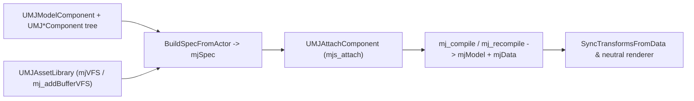

# Architecture: `MuJoCoSpec` (`mjSpec`) to native MuJoCo simulation

URLab's clean-slate `MuJoCoSpec` layer (`Source/URLab/{Public,Private}/MuJoCoSpec/` and `Source/URLabEditor/Private/MuJoCoSpec/`) builds and compiles models directly through MuJoCo 4.0.2's `mjSpec` C API (`mj_makeSpec`, `mj_parseXMLString`, `mjs_attach`, `mj_compile`, `mj_recompile`).

## Core pieces

- **`UMJModelComponent`** (`Source/URLab/Public/MuJoCoSpec/MJModelComponent.h`) owns the RAII handles (`FMJSpecHandle`, `FMJModelHandle`, `FMJDataHandle`, `FMJVFSHandle`), `DefaultClasses` (`TArray<FMJDefaultClassEntry>`), and `AssetLibrary` (`UMJAssetLibrary`). It builds the `mjSpec` from the owning Actor's component tree (`BuildSpecFromActor`), compiles (`CompileModel`) or recompiles in-place (`RecompileModel`), steps physics (`StepSimulation`), syncs body transforms (`SyncTransformsFromData`), and exports MJCF (`ExportXML` with `savecompiled=false`, `savecanonical=false`, `saveinertial=false`).
- **Spatial components** (`UMJSceneComponent` subclasses in `MJSceneComponents.h`): `UMJBodyComponent`, `UMJFrameComponent`, `UMJGeomComponent` (including `fromto`), `UMJJointComponent`, `UMJSiteComponent`, `UMJCameraComponent`, `UMJLightComponent`, and `UMJAttachComponent` (`mjs_attach`).
- **Non-spatial components** (`UMJActorComponent` subclasses in `MJActorComponents.h`): `UMJActuatorComponent` (using `EMJActuatorShortcut` mapped to `mjs_setTo*`), `UMJSensorComponent`, and `UMJTendonComponent`.
- **`UMJAssetLibrary`** (`MJAssetLibrary.h`) stores UE `UStaticMesh` and `UTexture2D` references alongside `RawBuffers` fed into `mjVFS` via `mj_addBufferVFS`. It also exposes MuJoCo 4 by-reference texture helpers (`IsTextureByReference` checking `tex_adr == -1`, `LoadTextureFromModel` via `mj_loadTexture`, and `EmbedModelAssets` via `mj_embedAssets`).
- **`FMJXmlImporterExporter`** (`Source/URLabEditor/Private/MuJoCoSpec/MJXmlImporterExporter.h`) imports MJCF XML into an Actor (`ImportXMLToActor`) or Blueprint SCS (`ImportXMLToBlueprintSCS`), and exports an Actor back to MJCF (`ExportActorToXML`).
- **Codegen** (`Tools/SpecCodegen/generate_ue_spec.py`) generates `MJSpecEnums.h`, `MJSpecStructs.h`, `MJSpecMarshal.h`, and `MJSpecMarshal.cpp` from MuJoCo 4 `introspect` and `mjcf.schema`. `Scripts/build_and_test_linux.sh` runs `generate_ue_spec.py --check` to prevent codegen drift.

See [Generation](concepts/generation.md), [The Component Model](concepts/model.md), and [Intended Design](architecture/intended_design.md) for the surrounding architecture.
