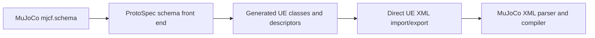

# Generation

URLab uses MuJoCo's pinned MJCF schema to generate its persistent authoring component tree. Each element becomes an Unreal component with typed optional properties, and generated descriptors map those properties to their source XML names, presence, formatting, references, defaults and legal child contexts.

The front end uses MuJoCo's own schema parser. The UE emitter creates 144 element classes, enum keyword tables, schema defaults, child dispatch, a small element identity enum, and typed field thunks. Ordinary source attributes, including expanded aliases, remain distinct generated fields. Alternate spatial spellings are consumed at import and normalized into UE spatial values. The direct gateway walks the component graph for both Blueprint SCS templates and live actors; there is no second persistent C++ document.

The native parser builds `mjSpec` and the native compiler builds `mjModel`. URLab retains a narrow resolver for orientation and full inertia, an include expander with source diagnostics, XML syntax handling, and a native `mjModel` comparison helper for parity tests. MuJoCo owns physics validation and shortcut semantics.

To regenerate or check the output, see [Regenerating MuJoCo authoring code](../contributing/generation.md).
