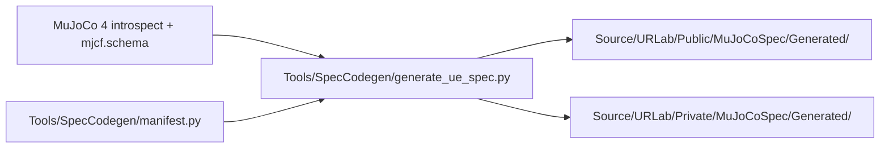

# Generation

URLab generates its `MuJoCoSpec` UE types (`UENUM`, `USTRUCT`) and `mjSpec` marshaling code directly from the pinned MuJoCo 4 submodule's `introspect` module and `mjcf.schema`.

`Tools/SpecCodegen/generate_ue_spec.py` emits four checked-in files:

- `Source/URLab/Public/MuJoCoSpec/Generated/MJSpecEnums.h`
- `Source/URLab/Public/MuJoCoSpec/Generated/MJSpecStructs.h`
- `Source/URLab/Public/MuJoCoSpec/Generated/MJSpecMarshal.h`
- `Source/URLab/Private/MuJoCoSpec/Generated/MJSpecMarshal.cpp`

Handwritten components (`UMJModelComponent`, `UMJBodyComponent`, `UMJGeomComponent`, etc.) hold these generated `FMJ*Spec` structs and call the generated marshaling functions to populate `mjs*` elements on `mjSpec*`. MuJoCo itself owns XML parsing, shortcut expansion (`mjs_setTo*`), `mjs_attach`, and `mj_compile` validation.

To regenerate or run the `--check` drift gate, see [Regenerating MuJoCoSpec code](../contributing/generation.md).
