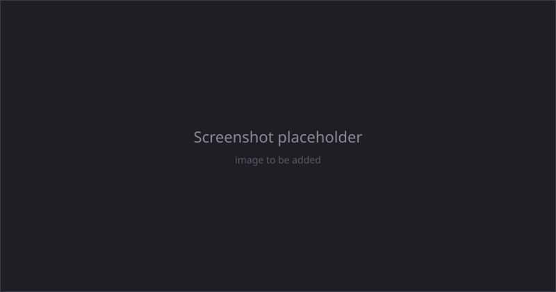

# Debug Visualization

Runtime overlays for inspecting the MuJoCo simulation during Play-in-Editor. Toggle them with number-row hotkeys, and tune their properties live from the Details panel on the Manager actor.

All overlays live on `UMjDebugVisualizer`, which is auto-created on the Manager. Input is handled by `UMjInputHandler`.

## Hotkeys

These are active during PIE:

| Key | Toggle | Purpose |
|-----|--------|---------|
| `1` | Contact force arrows | Yellow arrows at each active contact, scaled by normal force. |
| `2` | Articulation visual-mesh visibility | Hide imported visual meshes, keeping collision and debug overlays. |
| `3` | Articulation collision wireframes | Magenta wireframes of every articulation collision geom. |
| `4` | Joint axes and limit arcs | Coloured arrows showing each joint's axis and current/limit angle. |
| `5` | Quick-Convert collision wireframes | Same as `3` but for props spawned via Quick Convert. |
| `6` | Cycle body-shader overlay | Off, Island, Instance Segmentation, Semantic Segmentation, Off. See below. |
| `7` | Tendon/muscle tubes | Smooth tubes along every tendon, coloured by muscle activation. See below. |
| `P` | Pause/resume the physics thread | |
| `R` | Reset simulation state | |
| `O` | Toggle orbit and keyframe cameras | |
| `F` | Fire all impulse launchers | |

!!! tip
    Press `2` to hide visual meshes and `3` to show collision wireframes when you want to inspect contact shapes without visual clutter. See [Geometry & Collision](geometry.md) for what the collision overlay draws.

## Body-shader overlay (key `6`)

This cycles through three modes plus Off, repainting every articulation geom and Quick-Convert mesh. Original materials are cached on first use and restored when the overlay returns to Off or PIE ends.

- **Island** colours each body by its constraint island, the group of bodies connected through active contacts, joint limits, equality constraints, or friction loss. The colouring mirrors MuJoCo's native visualiser. Bodies with no degrees of freedom (worldbody, welded-to-world) read neutral grey.
- **Instance Segmentation** gives each body a unique hue, useful for per-body masks.
- **Semantic Segmentation** shares a hue across all instances of the same articulation class, so two Blueprints from the same class read as one colour.

When **sleep modulation** is on (default), sleeping bodies are dimmed and desaturated. Tune the value and saturation scales live in the Details panel.

!!! warning
    This overlay swaps real materials, so anything that renders the level (scene captures, `UMjCamera`, screenshot tools) captures the overlay rather than the underlying scene. It is a viewport debug tool. For persistent, clean RGB, depth, or mask streams, use per-camera capture modes instead, which are orthogonal to this overlay. See [Sensors & Cameras](sensors_cameras.md).

## Tendon and muscle tubes (key `7`)

Renders every tendon as a smooth tube. For muscle actuators, both the tube radius and colour track the muscle's activation in real time (relaxed reads thin and dark blue, contracted reads thick and bright red). Limited tendons without a muscle driver colour by their normalised length; neutral tendons read mid-purple. The path follows MuJoCo's post-kinematics tendon route, curving around any wrapping geoms. Tune `TendonTubeRadius` and `TendonArcSubdivisions` in the Details panel.

## Overlays on a render server

A consumer renderer — an instance with `-URLabDrive=subscribe:` or `request`, described in
[render roles](../concepts/render_roles.md) — runs no physics, so it has no `mjData`
of its own to derive overlays from. It can still draw them, and how much it can draw
depends on where the data comes from.

Anything derivable from the streamed transforms plus the static model is free: body,
geom and site frames, camera and light glyphs, inertia boxes and bounding volumes.
Anything that lives in `mjData` — contacts, contact forces, constraint and sensor
decor, subtree centres of mass, actuator colouring, tendon wrap paths — has to be
sent by the owner, and the owner only serialises it for subscribers that asked.

Two things control this at boot:

- `-URLabScene=overlay=<mask>` takes an `mjVIS_*` bitmask, decimal or `0x`-hex. It
  seeds the `mj.RenderOverlayMask` console variable, which selects which overlays the
  subscriber draws, and it tells the subscriber to negotiate the owner's debug tier so the
  owner-side data actually arrives.
- `-URLabScene=maxcontacts=<n>` caps how many contact points the **owner** puts on
  each frame. It is a bandwidth control rather than a drawing limit, and `0` or
  absent means uncapped.

`mj.RenderOverlayMask` is an ordinary console variable, so an operator can change
the mask at runtime without relaunching; the negotiation with the owner, however,
happens once at subscribe time.

Overlays are drawn by `UMjOverlayRenderer` through pooled instanced static meshes —
one pool per unit primitive, with per-instance colour and alpha in custom data
feeding a single master material — rather than through immediate-mode debug drawing,
so hundreds of contacts cost a handful of draw calls. The master material is
`/UnrealRoboticsLab/Materials/M_MjOverlay`; if it is missing from a cooked build the
renderer degrades to opaque per-colour pools, which is usually the first sign that a
packaged server did not cook the plugin's materials. See
[packaging a render server](render_server_packaging.md) for the fix.

## Next steps

- [Geometry & Collision](geometry.md) for contact filtering and what the collision overlay shows.
- [Interaction](interaction.md) for mouse perturbation, which uses these overlays for its drag gizmos.
- [Simulate Dashboard](dashboard.md) for the in-editor control panel.
