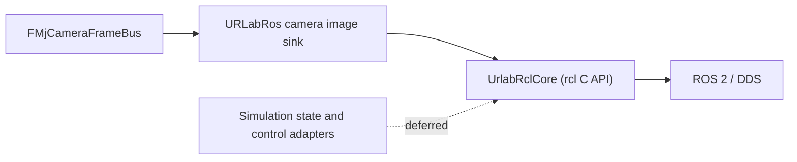

# ROS 2 Integration

ROS support is currently in a transitional state. The optional `URLabRos`
module and its direct rcl C API seam remain, but the legacy manager-based ROS
state publishers, output-provider registry, subscriptions, and control RPC
services have been removed.

ROS state and control alignment is deferred until the core runtime,
state, control, and ownership interfaces are settled. The removed topics and
services are not part of the current API.

## Current scope

The retained runtime integration is the independent camera image sink in
`Source/URLabRos/Private/URLabRos.cpp`. It subscribes to the core
`FMjCameraFrameBus` and contains a lazy per-camera
`sensor_msgs/Image` publisher:

- topic: `/<canonical-camera-name>/image`
- colour encoding: `bgra8`
- depth encoding: `32FC1`
- segmentation encoding: `32SC2`

The sink publishes only when an `FURLabRosContext` has already been
initialized and is available. Module startup installs the frame-bus sink but
does not currently initialize that context. This retained source path therefore
does not constitute a promise of working end-to-end camera publication.
`camera_info` belonged to the removed provider path and is not currently
published by the sink.

The former ROS state and control surface included joint state, TF, odometry,
scene/map/sensor and robot-description output, plus command subscriptions and
claim/release services. Those manager-based implementations are gone. Examples
or launch files that depend on those topics, including the existing MoveIt
example, do not describe the current plugin API.

## Build configuration

`URLabRos.Build.cs` looks for a ROS prefix in `URLAB_ROS2_ROOT`, then at
`<plugin>/third_party/install/ros2`. The prefix must provide the ROS headers
and libraries expected by the module's pinned rcl link list. If neither
location exists, the module defines `URLAB_WITH_ROS2=0` and its ROS calls
compile out.

For an explicitly configured ROS install:

```bash
export URLAB_ROS2_ROOT=/path/to/ros/prefix
```

Runtime ROS libraries must also be discoverable by the platform loader when
loading a ROS-enabled build.

## Architecture boundary



ROS remains a separate adapter rather than a rendering mode or socket-backend
replacement. Future state/control work must consume the settled model-level
runtime interfaces and must not restore dependencies on the authoring manager
or runtime articulation actors.

No live ROS validation was run during the architecture audit or this retirement
of the legacy providers. Treat the statements above as a description of the
current source boundary, not verified end-to-end ROS behavior.
